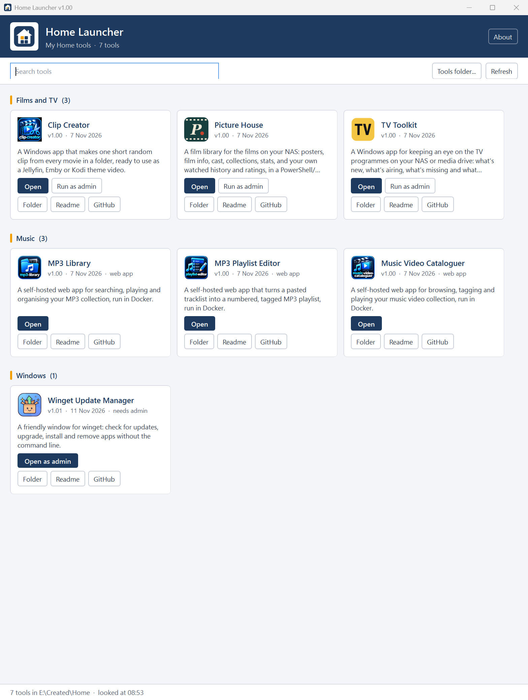

<p align="center">
  
</p>

# Home Launcher

One window that lists every Home tool, shows its version and opens it, its folder, its help guide or its GitHub repo.

    

## ✨ Features

A PowerShell/WPF window built on the shared Launcher Engine. It looks in the Home folder, and in `Home\Private\` only once unlocked.

- **Finds the tools itself.** Every folder next to `Home-Launcher\` with a `Builds\` or `Source\` folder is a tool. A new tool appears on the next start (or F5) with nothing to register.
- **Tiles grouped by category**: Films and TV, Music and Windows. Each tile shows the tool's icon, name, version, last-updated date and one-line description, all read from the tool's own `build.json`, `CHANGELOG.md` and `README.md`.
- **Starts the right thing**: the newest `<App Name> v<version>.exe` in the tool's `Builds\`, or the main script in `Source\src\` if there's no build yet. Tools that need admin rights, such as Winget Update Manager, say **Open as admin**; any other tool can be started with **Run as admin**.
- **Docker web apps** (MP3 Library, MP3 Playlist Editor, Music Video Cataloguer) open their page in the browser.
- **Quick links** on every tile: **Folder** (opens the project folder), **Help** (the help guide in `docs\`, or the README) and **GitHub** (the repo, taken from the tool's git settings).
- **Search** by name, description or category. Enter starts the only match, Esc clears.
- **Private tools stay hidden.** Nothing in `Home\Private\` is shown, and nothing hints that it exists, until you press Ctrl+Shift+U and type the launcher password. They hide again when you press **Lock** (or Ctrl+Shift+U), after 10 minutes without using the launcher, or when it closes.
- **Opens the vault.** Once `Home\_vault\Private.vhdx` exists, the same password also attaches and unlocks that BitLocker container, and locking or closing the launcher locks it again.
- No internet lookups, nothing installed, settings in `%APPDATA%`. The exe is self-contained.

## 🖼️ Screenshots



## 📋 Requirements

- Windows 10 or 11 with Windows PowerShell 5.1 (or PowerShell 7).
- The Home tools in the house-style layout: `Home\<Tool>\Builds\` and `Home\<Tool>\Source\`, with private tools in `Home\Private\<Tool>\`.
- For the vault: Windows Pro or higher (BitLocker), and an administrator account to accept the UAC prompt.
- To run from source or build the exe: the Launcher Engine (v1.01 or later) at `E:\Created\_shared\Launcher-Engine\Source\`. It is a private repo.

## 📦 Installation

**Exe:** download `Home Launcher v1.00.exe` from the [latest release](../../releases/latest) and put it in `Home\Home-Launcher\Builds\`. From there it finds the tools in `Home\` with no setup. Anywhere else, use **Tools folder...** once to point it at the Home folder.

**Script:** clone this repo into `Home\Home-Launcher\Source\` and the Launcher Engine into `E:\Created\_shared\Launcher-Engine\Source\`, then run `Start Home Launcher.cmd`. It starts `src\Home-Launcher.ps1` with the execution policy bypassed for that run only.

### Build the exe

Double-click `Build-Exe.cmd`. It finds the engine in `E:\Created\_shared\`, checks the version in the script matches the newest CHANGELOG entry and the engine is v1.01 or later, runs PSScriptAnalyzer (if installed) on the wrapper and the engine, then pastes the engine, `profile.home.json` and the icon into one script and compiles it with [ps2exe](https://github.com/MScholtes/PS2EXE) (`-STA -noConsole`). The result is saved to the project's `Builds\` folder, outside the repo, as `Home Launcher v<version>.exe`, and needs no other files. It installs ps2exe for your user the first time and logs to `Build-Exe.log`. Set the `LAUNCHER_ENGINE` environment variable to build against another copy of the engine.

The exe is not signed by this script. Once `E:\Created\_shared\Build-Tool.ps1` is in place it replaces `Build-Exe.cmd` and signs the exe:

```powershell
E:\Created\_shared\Build-Tool.ps1 -Project "E:\Created\Home\Home-Launcher"
```

## 🚀 Usage

Start the exe (or `Start Home Launcher.cmd`). Double-click a tile or press **Open** to start a tool. The status bar says what was started, and the About box shows the version, the folder being scanned and the shortcuts.

| Key | Does |
| --- | --- |
| Ctrl+F | Search |
| Enter | Start the only tool that matches the search |
| Esc | Clear the search |
| F5 | Look for tools again |
| Ctrl+Shift+U | Unlock the private tools, or lock them again |

### Private tools

The first time you press Ctrl+Shift+U the launcher asks you to choose a password. After that it asks for it, and the **Private** group appears with **Lock** and **Password...** buttons in the header. Only a salted PBKDF2-SHA256 hash of the password is saved. The password is a privacy curtain: anyone can still start a tool's exe directly, so the real protection is the encrypted vault.

When `Home\_vault\Private.vhdx` exists and is locked, unlocking also shows a UAC prompt and opens the vault with the same password, so set the launcher password to match the vault's BitLocker password. Locking, 10 minutes idle or closing the launcher locks the vault again (another UAC prompt). If a private tool is still running from the vault, the launcher asks first, and an idle lock only hides the tiles.

To set up the vault, follow "Vault setup" in the Launcher & GitHub Standards Proposal.

## ⚙️ Configuration

`src\profile.home.json` sets what the launcher looks like and where it looks. The exe has it built in, so change it and rebuild.

| Setting | Does |
| --- | --- |
| `Name`, `Title`, `Subtitle` | Window and header text |
| `Roots` | Folders to scan, relative to the launcher's project folder (`".."` = the Home folder) |
| `Logo`, `Icon` | Images from `assets\` for the header and the window |
| `Theme` | `Accent`, `AccentText`, `Highlight` and `Background` colours |
| `Categories` | The order the categories are shown in |
| `DefaultCategory` | Category for tools that don't have one |
| `Exclude` | Folders to skip: the launcher itself, `Private` (scanned separately once unlocked) and Media Share Mapper (left out of the launcher by the standards; remove it from the list to show it) |
| `Tools` | Per-tool defaults by folder name, e.g. `"MP3-Library": { "Category": "Music", "Url": "http://localhost:3000" }` |
| `PrivateLock` | `true` turns on the Ctrl+Shift+U lock |
| `PrivateRoots` | Folders whose tools are all private (`..\Private`) |
| `PrivateCategory` | The group private tools are shown in |
| `IdleLockMinutes` | Minutes without use before private tools hide again (`0` = only on close) |
| `Vault` | `Image` (`..\_vault\Private.vhdx`) and `MountPath` (`..\Private`) |

Private tools are found by their folder, so their names are never in the profile. A tool can also carry its own `launcher.json` (in its project folder or `Source\`) to set `Name`, `Category`, `Description`, `Icon`, `Help`, `RequireAdmin`, `Private`, `Hidden`, `Target`, `RunMode` or `Url`. It wins over the profile.

Settings saved on the PC are in `%APPDATA%\Home Launcher\settings.json`: the folder chosen with **Tools folder...** and the password hash. Delete the file to go back to the default folder and choose a new password.

## 📝 Changelog

See [CHANGELOG.md](CHANGELOG.md).

## 📄 Licence

MIT, see [LICENSE](LICENSE). Copyright (c) 2026 Jason Rhodes.
